# Regex to Complement Regex

Это учебный проект по курсу "алгоритмы и теория формальных языков" (домашнее задание). Программа получает регулярное выражение, строит для него цепочку промежуточных представлений (AST, всякие автоматы) и возвращает регулярное выражение для дополнения исходного языка.

Дополнение всегда строится относительно явно заданного алфавита. В примерах ниже используется небольшой алфавит - `{a, b}`.

## Поддерживаемый синтаксис

- `a`–`z` — символы алфавита;
- `0` — пустой язык;
- `1` — пустое слово `ε`;
- `R|S` — альтернатива;
- `RS` — конкатенация;
- `R*` — звезда Клини;
- `R+` — одно или больше повторений;
- `(R)` — изменение порядка выполнения операций.

## Установка и запуск

Требуются Python 3 и системная утилита Graphviz `dot`.

```bash
./install.sh
.venv/bin/python main.py
```

Использование из Python:

```python
from regex_complement import regex_to_complement_regex

result = regex_to_complement_regex(
    "(ab)*b+a(1|b(a|b))",
    alphabet=frozenset("ab"),
    generate_images=True,
)
print(result)
```

Если `generate_images=False`, алгоритм не создаёт DOT- и SVG-файлы.

## Пример полного преобразования

Исходное выражение:

```text
(ab)*b+a(1|b(a|b))
```

Полученное выражение для дополнительного языка:

```text
1|a(ba)*(1|b)|(b|a(ba)*bb)b*|a(ba)*a(a|b)*|(b|a(ba)*bb)b*aa(a|b)*|(b|a(ba)*bb)b*ab|(b|a(ba)*bb)b*ab(a|b)(a|b)(a|b)*
```

Ну, вроде верно.

### 1. Построение AST

Лексер преобразует строку в токены, а рекурсивный нисходящий парсер строит AST с учётом приоритетов альтернации, конкатенации и постфиксных операторов.

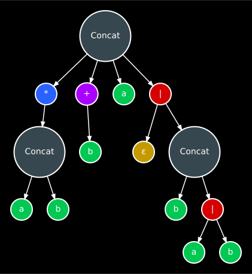

### 2. Построение ε-NFA

По AST выполняется конструкция Томпсона. Каждый узел создаёт небольшой фрагмент автомата с одним входом и одним выходом, после чего фрагменты соединяются ε-переходами.

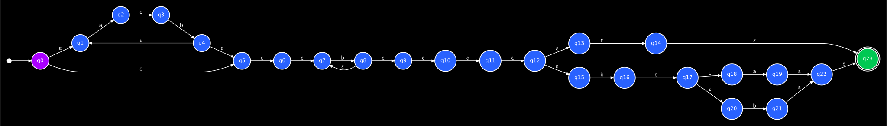

### 3. Удаление ε-переходов

Классический алгоритм был немного изменён, чтобы не сохранять служебные вершины конструкции Томпсона (т.е. такие, что среди всех рёбер, и входящих и исходящих, все равны эпсилону). Новый автомат содержит начальное состояние и состояния, в которые можно попасть непосредственно после чтения настоящего символа.

Перед чтением символа используется ε-замыкание текущего состояния, а достижимость принимающего состояния через завершающие ε-переходы переносится в признак принимающего состояния. Благодаря этому автомат получается заметно меньше и не содержит вершин, используемых только для ε-переходов.

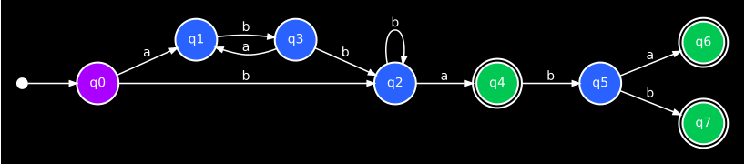

### 4. Детерминизация

Применяется конструкция подмножеств. Каждое состояние DFA соответствует множеству состояний NFA. Пустое множество сохраняется как поглощающее состояние, поэтому DFA является полным.

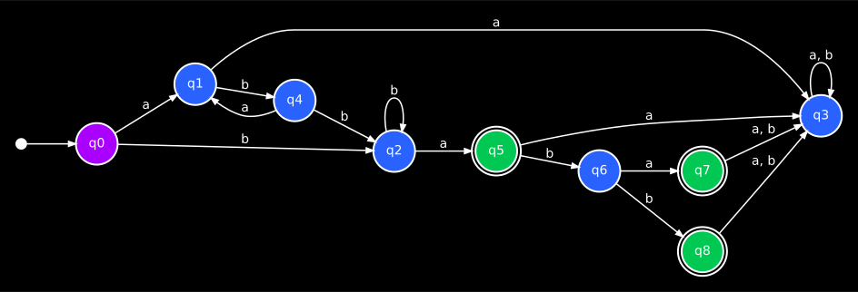

### 5. Минимизация DFA

Сначала удаляются недостижимые состояния. Затем принимающие и непринимающие состояния разбиваются на классы, которые уточняются по классам назначения всех переходов. Каждый итоговый класс становится одним состоянием минимального DFA.

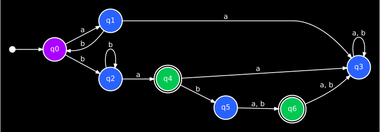

### 6. Построение дополнения

Поскольку DFA полный, для получения дополнительного языка достаточно поменять принимающие и непринимающие состояния местами. Переходы и начальное состояние не изменяются.

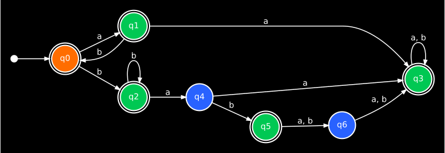

### 7. Преобразование DFA обратно в регулярное выражение

DFA преобразуется в GNFA: добавляются отдельные начальное и конечное состояния, а рёбра получают метки в виде AST регулярных выражений. При удалении состояния `k` каждое ребро `i → j` обновляется по формуле:

```text
R(i, j) = R(i, j) | R(i, k)(R(k, k))*R(k, j)
```

После каждого удаления AST на рёбрах упрощаются. Когда остаются только синтетические начальное и конечное состояния, метка между ними является итоговым регулярным выражением.

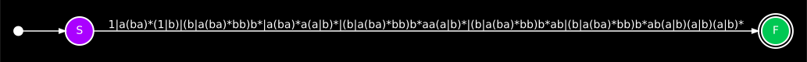

<details>
<summary>Все шаги удаления состояний</summary>

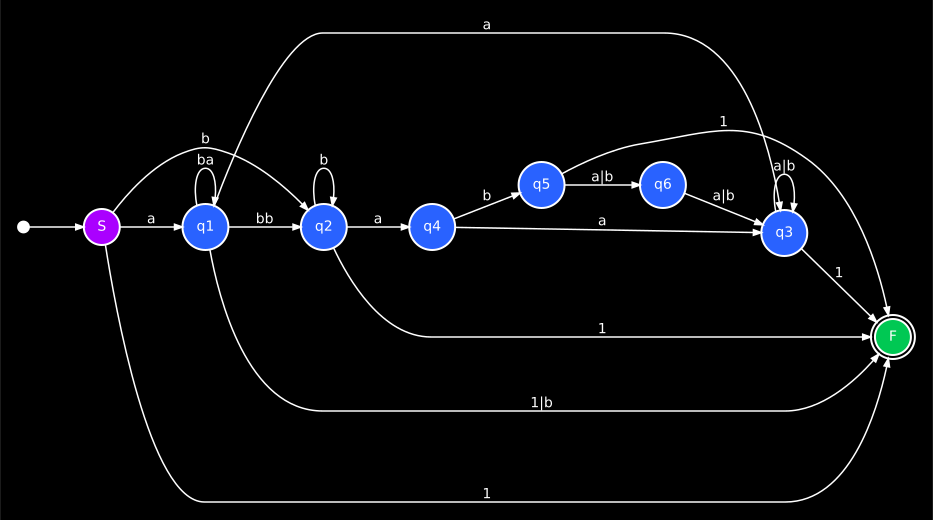

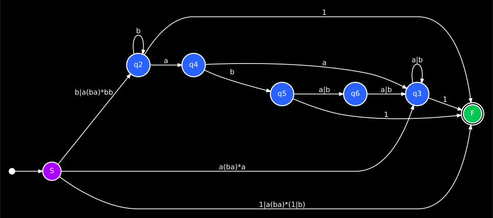

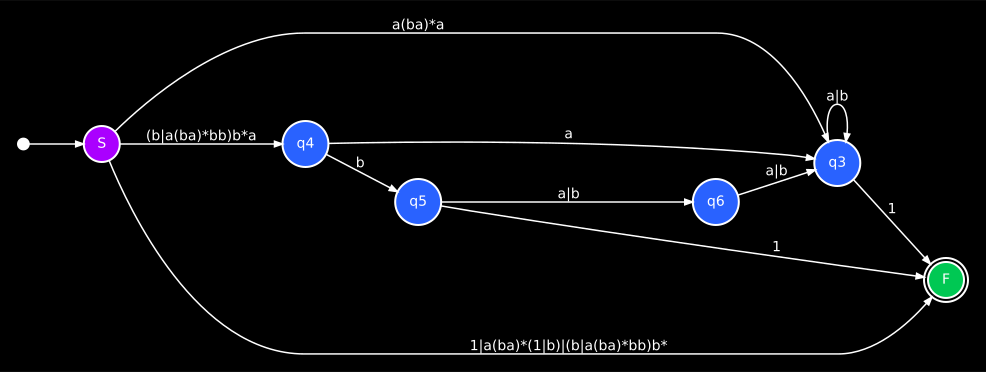

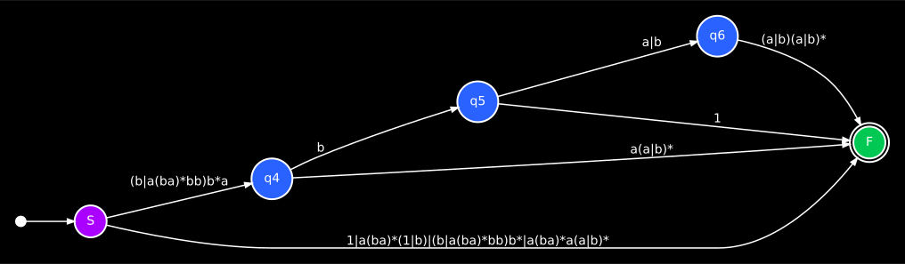

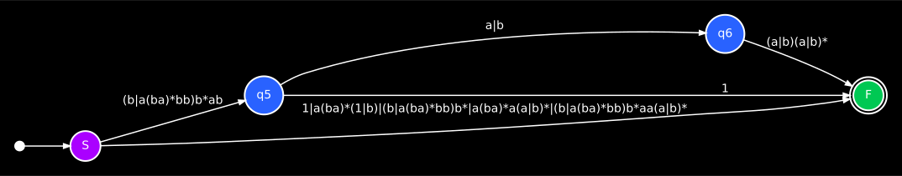

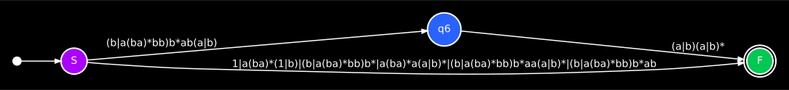


</details>

## Тесты

```bash
.venv/bin/python -m unittest discover -v
```

Тесты отдельно покрывают лексер, парсер, AST, конструкции NFA и DFA, удаление ε-переходов, детерминизацию, минимизацию, дополнение, удаление состояний GNFA и обратную сериализацию AST в строку.
